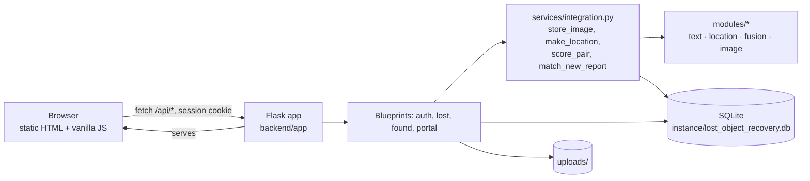
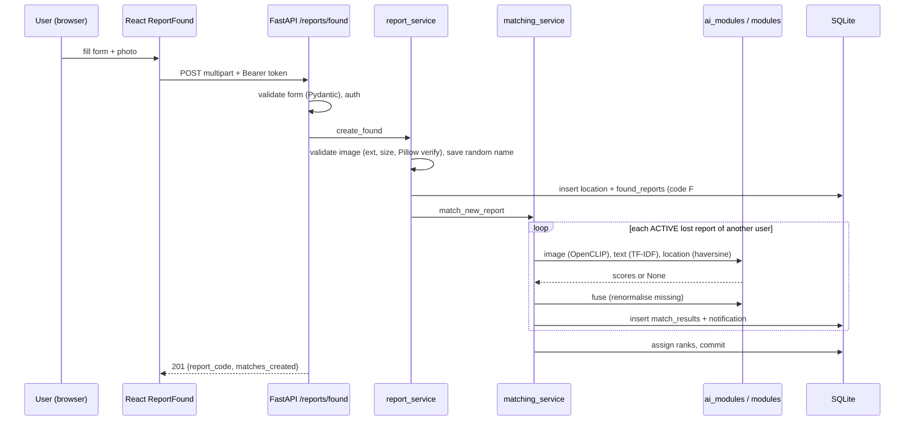
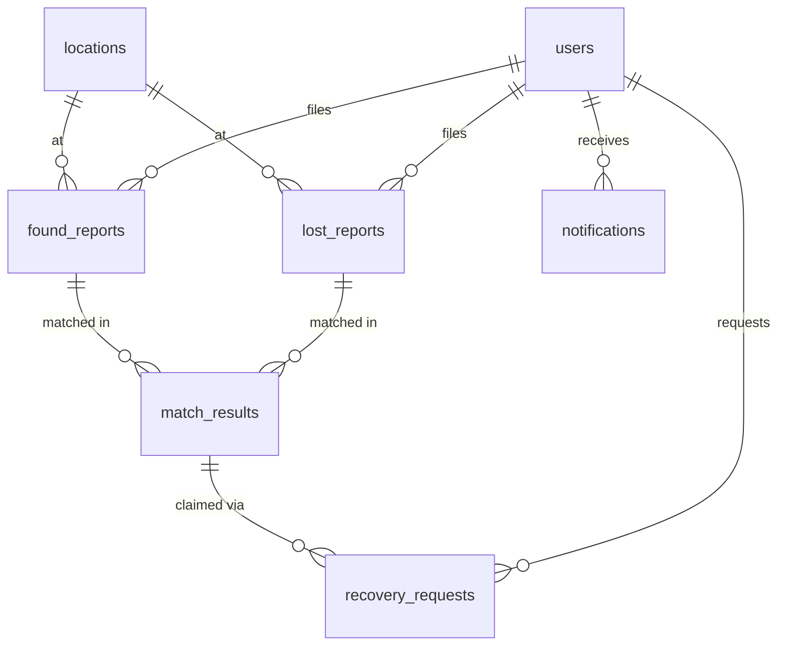

# Architecture

## 1. Existing (legacy) architecture



Flask both served the pages and the JSON API. Logic was split between route handlers and `integration.py`.

## 2. Target (implemented) architecture

```mermaid
flowchart LR
  subgraph FE[frontend/ — React + TS + Vite]
    P[Pages] --> C[api/client.ts<br/>typed fetch + bearer token]
    A[AuthContext]
  end
  C -- "HTTP/JSON  /api/v1/*" --> API
  subgraph BE[server/ — FastAPI]
    API[api/v1.py routes<br/>+ deps (auth)] --> SCH[schemas.py<br/>Pydantic validation]
    API --> SVC[services/<br/>auth · report · matching · portal · storage]
    SVC --> ORM[models.py + db/session.py<br/>SQLAlchemy 2]
    SVC --> INT[integrations/ai_modules.py]
    ERR[core/errors.py<br/>one error shape]
  end
  ORM --> DB[(SQLite — same legacy file)]
  SVC --> UP[(uploads/)]
  INT --> MOD[modules/<br/>text · location · fusion · image<br/>unchanged]
```

Layers were added only where they carry weight: no repository layer (SQLAlchemy sessions in services are enough for this size) and no separate "database" package beyond the session module.

## 3. Responsibilities

| Component | Responsibility |
|---|---|
| `api/v1.py` | Parse HTTP input, call one service, shape the response. No business rules |
| `api/deps.py` | Resolve bearer token → user; `StaffUser` guard |
| `schemas.py` | All input validation (lengths, email, coordinate ranges, custody enum) and response shapes |
| `services/*` | Business rules and authorisation (owner-only, staff-only, idempotent interest) |
| `services/matching_service.py` | Pair scoring, de-duplication, ranking, notification creation |
| `integrations/ai_modules.py` | Only place that imports teammates' modules; normalises "missing signal" to `None` |
| `core/errors.py` | Centralised handlers → `{"error":{"code","message","details?"}}` |
| `core/config.py` | Env-driven settings; no hard-coded secret (random per-process key if unset) |
| `frontend/src/api/client.ts` | Only code that talks to the backend; error normalisation, 401 handling |

## 4. Request flow: submit a found item



## 5. Data model (unchanged from legacy)



`match_results` has a unique constraint on `(lost_report_id, found_report_id)`. Tables are only *created if missing*; nothing is altered or dropped.

## 6. Authentication & authorisation

* `POST /auth/login|register` → JWT (HS256, `ACCESS_TOKEN_MINUTES`, default 12 h). The SPA keeps it in `localStorage` and sends `Authorization: Bearer`. Bearer tokens (not cookies) remove the CSRF class of problem; the trade-off is XSS exposure of the token, so the frontend never renders unescaped HTML (React escapes by default).
* Password hashes use the werkzeug format so **existing Flask users keep working**.
* Rules: matches/images are visible to the owner (and staff); interest is owner-only; staff routes require `role == "staff"`.

## 7. Frontend structure

`src/api` (client + types) · `src/auth` (context) · `src/components` (Layout/guards, loading/error/empty states, `SecureImage`) · `src/pages`. Every data view has loading, error (with retry) and empty states. Images are fetched with the token and shown via blob URLs because they are access-controlled.

## 8. Integration points

* Disk: `backend/uploads/` (random filenames, original name discarded).
* AI: in-process Python calls; image model loaded lazily once (`lru_cache`); failure to load disables image matching for the process and is logged, never faked.
* Future: move matching to a background worker if report volume grows (inference currently runs inside the request).
